<div align="center">

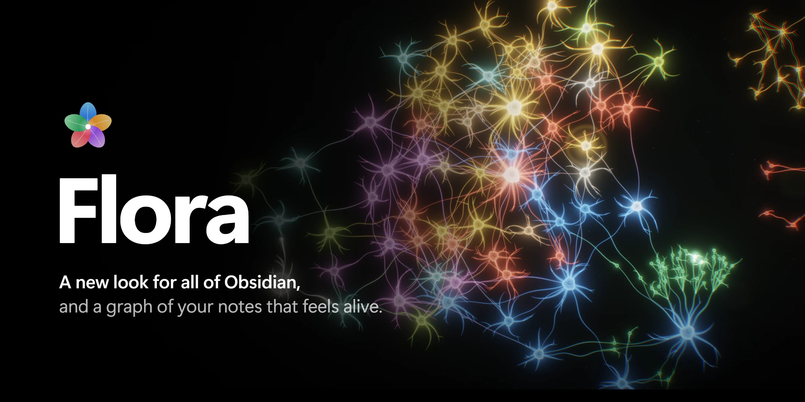

<br />
<br />

<a href="README.md"></a>
<a href="README.ru.md"></a>

<br />

<a href="https://github.com/ParanoaiDev/obsidian-flora/releases/latest"></a>
<a href="https://community.obsidian.md/plugins/flora"></a>
<a href="https://obsidian.md"></a>
<a href="https://github.com/ParanoaiDev/obsidian-flora/releases"></a>
<a href="LICENSE"></a>


<a href="PRIVACY.md"></a>

<br />
<br />

**Flora** redesigns every surface of Obsidian in a calm, glassy style inspired by iOS,<br />
and turns your vault into living neural tissue: notes are cells, links are glowing axons,<br />
and signals run along them while you think.

<br />

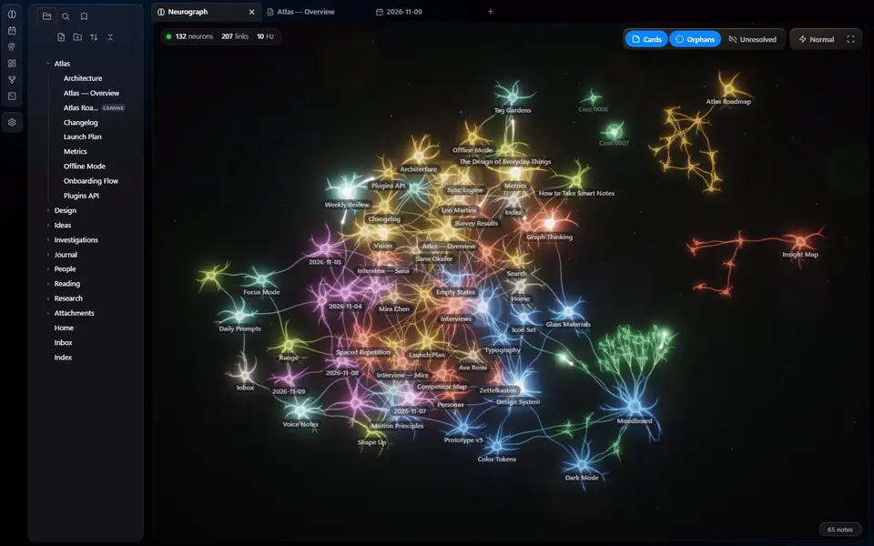

<sub>Recorded straight from the Neurograph. Hover a cell and it lights up together with everything it links to.</sub>

</div>

<br />

## ✨ What's inside

<table>
<tr>
<td width="50%" valign="top">

### 🪟 A new look for all of Obsidian
Glass sidebars, capsule tabs and a floating status bar over a soft colored backdrop. Text sits on a solid card so it stays easy to read. Light and dark mode, five accent colors, and it works on top of any theme.

</td>
<td width="50%" valign="top">

### 🧠 Neurograph
A view of your whole vault as living tissue. Big notes grow crowns of dendrites, links carry pulses from cell to cell, canvases bloom into their own clusters. Hover a cell to light it up, click to open the note.

</td>
</tr>
<tr>
<td valign="top">

### 🕸️ Graph view, re-drawn
The built-in graph and the local graph keep everything you rely on (filters, groups, colors, search, dragging) and are simply drawn as neurons instead of dots.

</td>
<td valign="top">

### 🌌 Canvas
A deep-space backdrop with soft nebulae, dark glass cards, and connections that become living axons. Pulses travel along the arrows and hand off to the next card in the chain.

</td>
</tr>
<tr>
<td valign="top">

### 📅 Today's journal
A header for daily notes: the date, day-to-day navigation, dots for the month, a live band with the notes you touched that day, a ready-made template and auto-tasks. Every new line under **Tasks** turns into a checkbox by itself.

</td>
<td valign="top">

### 🔎 Investigation board
A case board for OSINT and research: entities (people, organizations, accounts, emails, phones, domains, IPs, places, vehicles, documents), links, a timeline and sources graded on the A–F / 1–6 scale, plus a live link map. Each case is a plain note.

</td>
</tr>
</table>

Every part can be switched on and off on its own in **Settings → Flora**.

<br />

## 📸 Gallery

<div align="center">

### The whole app, in light and dark

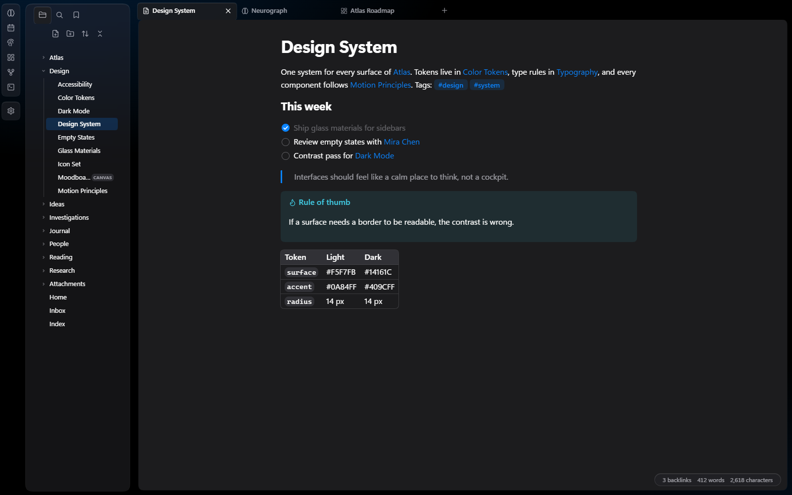
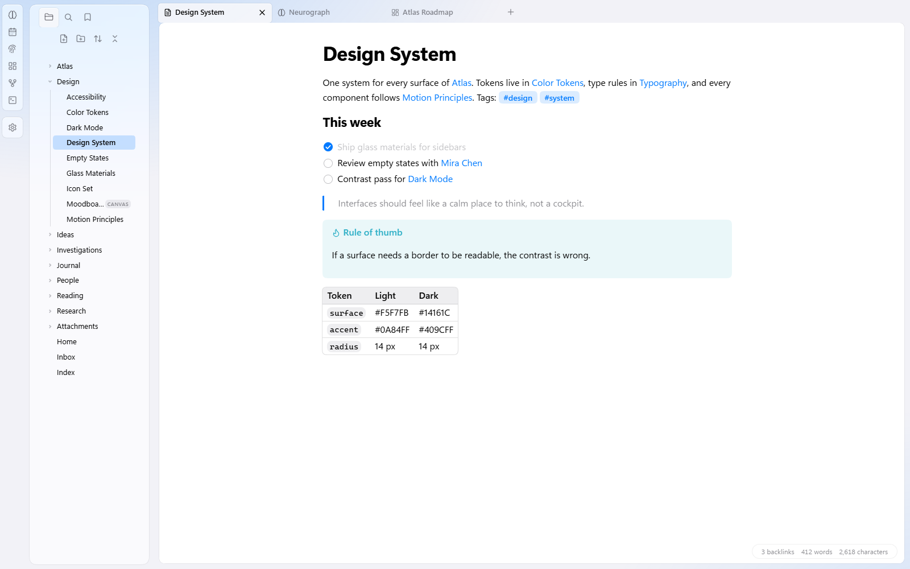

<br />
<br />

### Neurograph

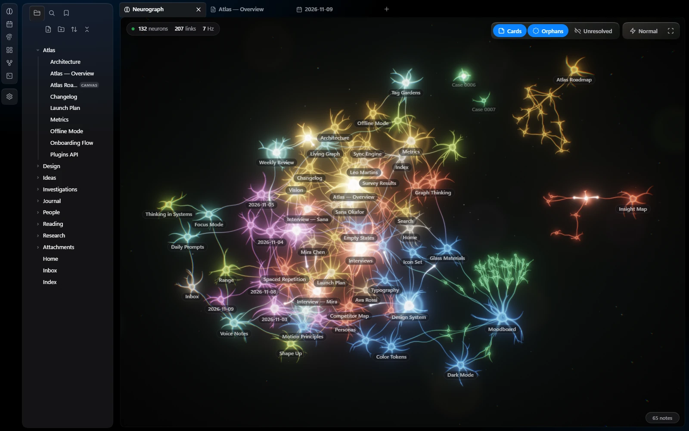

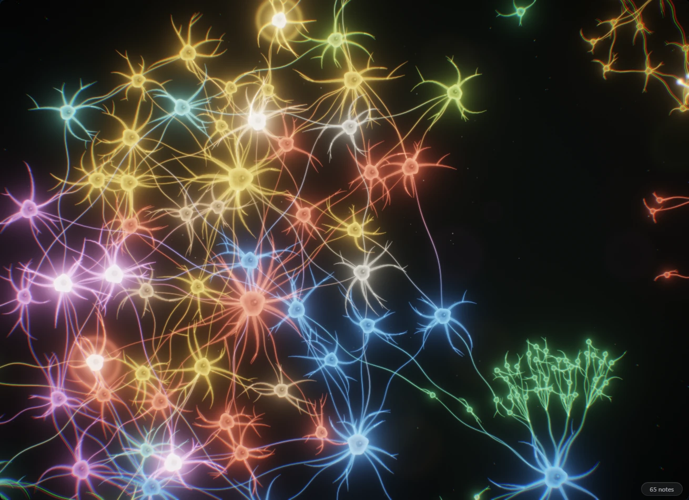

<sub>Up close, each note is a cell with a nucleus, a wobbling membrane and its own dendrites. Signals fire on their own and spread along real links.</sub>

<br />
<br />

### Canvas

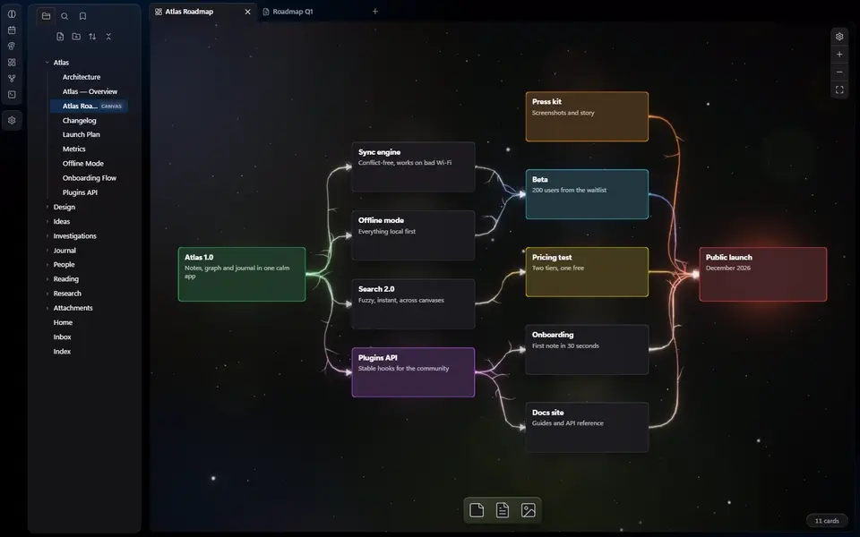

<br />
<br />

### Today's journal

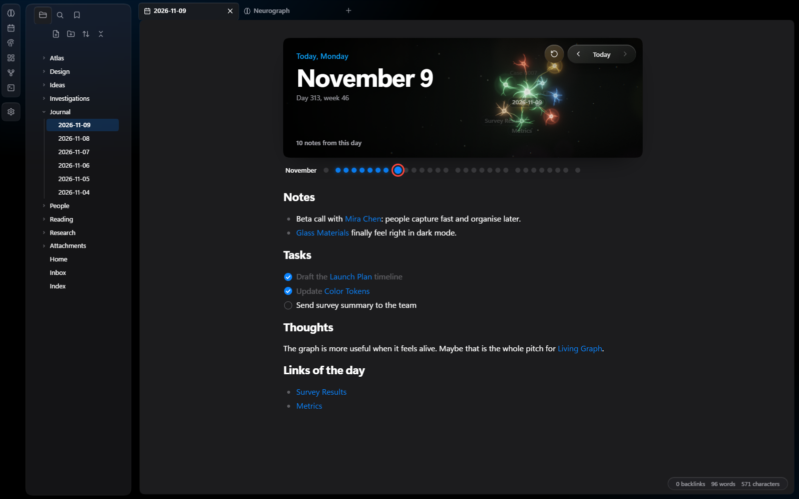
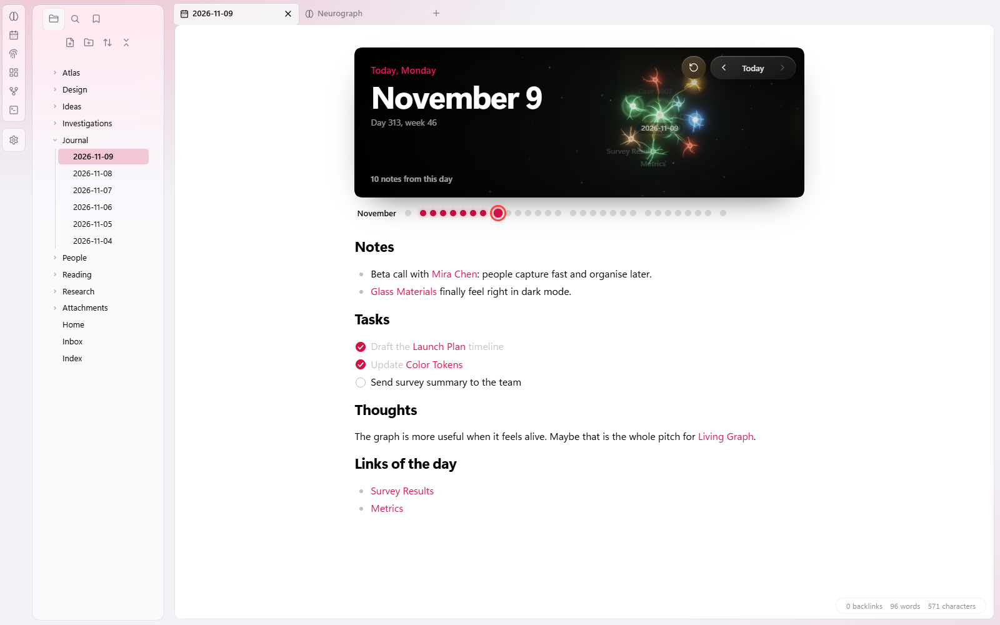

<br />
<br />

### Investigation board

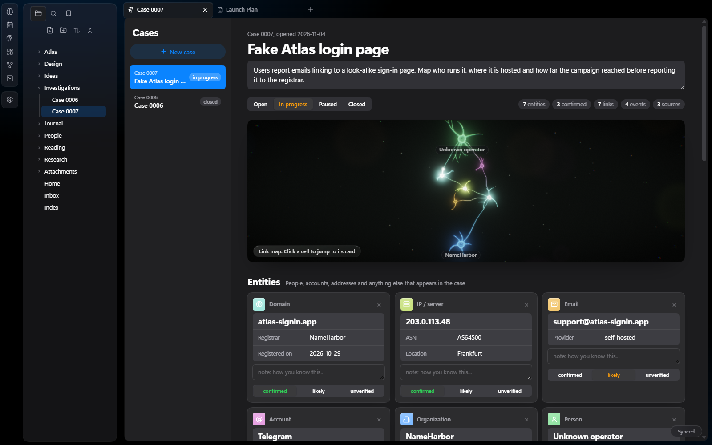

<br />
<br />

### Start screen

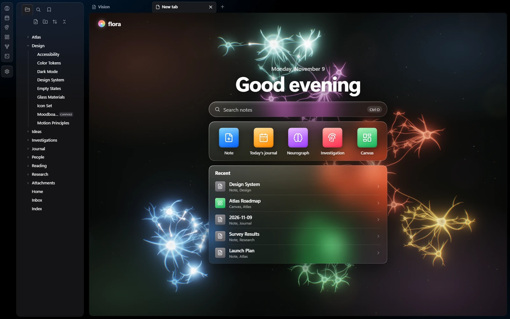

<sub>Replaces "No file is open" in every empty tab.</sub>

<br />
<br />

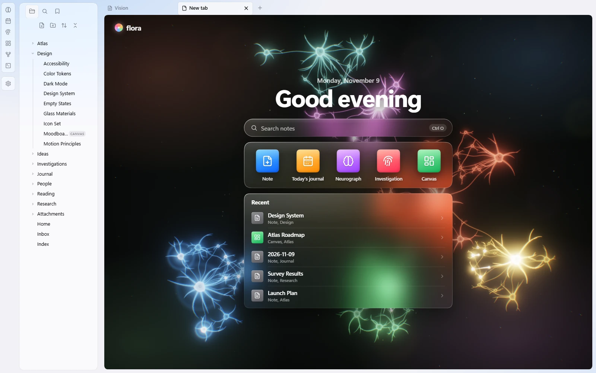

</div>

<sub>All screenshots use a made-up demo vault. Nothing in them is real data.</sub>

<br />

## 🚀 Install

### From Obsidian (recommended)

Flora is in the official [Obsidian community directory](https://community.obsidian.md/plugins/flora).

1. In Obsidian, open **Settings → Community plugins** and turn on community plugins if they are off.
2. Select **Browse**, search for **Flora** and select **Install**, then **Enable**.

Or open the [Flora page in the directory](https://community.obsidian.md/plugins/flora) and select **Add to Obsidian**.

### One command

Installs or updates Flora from the latest release. The script finds your vaults, asks which one to use, downloads the plugin into it and turns it on. Your Flora settings are kept.

**Windows** (PowerShell):

```powershell
irm https://raw.githubusercontent.com/ParanoaiDev/obsidian-flora/main/install.ps1 | iex
```

**macOS and Linux** (Terminal):

```bash
curl -fsSL https://raw.githubusercontent.com/ParanoaiDev/obsidian-flora/main/install.sh | bash
```

Restart Obsidian afterwards if it was open. You can read both scripts first: [install.ps1](install.ps1), [install.sh](install.sh).

<details>
<summary><b>Choose the vault yourself</b></summary>
<br />

Windows:

```powershell
& ([scriptblock]::Create((irm https://raw.githubusercontent.com/ParanoaiDev/obsidian-flora/main/install.ps1))) -Vault "C:\path\to\vault"
```

macOS and Linux:

```bash
curl -fsSL https://raw.githubusercontent.com/ParanoaiDev/obsidian-flora/main/install.sh | bash -s -- "/path/to/vault"
```

</details>

<details>
<summary><b>By hand</b></summary>
<br />

1. Open the [latest release](https://github.com/ParanoaiDev/obsidian-flora/releases/latest) and download `main.js`, `manifest.json` and `styles.css`.
2. Put the three files into `<your vault>/.obsidian/plugins/flora/`. Create the folder if it doesn't exist.
3. In Obsidian, open **Settings → Community plugins** and enable **Flora**.

</details>

<details>
<summary><b>With BRAT</b></summary>
<br />

1. Install [BRAT](https://github.com/TfTHacker/obsidian42-brat) from the community plugins.
2. Run **BRAT: Add a beta plugin for testing** and paste `ParanoaiDev/obsidian-flora`.
3. Enable **Flora** in **Settings → Community plugins**.

</details>

<details>
<summary><b>Build from source</b></summary>
<br />

You only need [Node.js](https://nodejs.org). There are no dependencies to install.

```bash
git clone https://github.com/ParanoaiDev/obsidian-flora.git
cd obsidian-flora
node build.js
```

`main.js` and `styles.css` land in the repository root, next to `manifest.json`. You can also build straight into a vault:

```bash
node build.js "/path/to/vault/.obsidian/plugins/flora"
```

</details>

<br />

## ⌨️ Commands

| Command | What it does |
| --- | --- |
| **Flora: Open Neurograph** | Opens your vault as living tissue in a new tab |
| **Flora: Open today's journal** | Opens or creates today's daily note with the journal header |
| **Flora: Open the investigation board** | Opens the case board with your cases |
| **Flora: New case** | Creates a new case note and opens it on the board |
| **Flora: Toggle the neural look of the graph view** | Switches the built-in graph between neurons and the original style |

The Neurograph and the investigation board also have their own icons in the left ribbon.

<br />

## ⚙️ Settings

| Setting | Default | |
| --- | --- | --- |
| Language | Auto | Follows Obsidian. English and Russian are built in. |
| Flora design | On | The new look for the whole app |
| Accent color | Blue | Blue, green, orange, pink or graphite |
| Start screen in empty tabs | On | Living tissue, quick actions and recent notes |
| Neural look for the graph view | On | The built-in graph, drawn as neurons |
| Neural look for the local graph | On | The same for the local graph in the sidebar |
| Scale and counters | On | Counters and a scale in the corners of the graph |
| Neural look for canvases | On | Space backdrop, glass cards and living connections |
| Today's journal | On | The header for daily notes |
| Auto tasks | On | New lines under **Tasks** become checkboxes |
| Neuron activity | ×1 | How often cells fire on their own, from off to ×4 |

<br />

## 🔋 Built to stay light

- **One GPU pass.** The living layers are drawn with WebGL2: HDR bloom, ACES tone mapping and instanced cells in a single canvas per view.
- **Frame budget.** 30 fps when idle, 60 while you drag or zoom, 12 when the window is in the background. Embedded views (the journal band, the case map) pause when you scroll them out of sight.
- **Zero dependencies.** A single `main.js` and a single `styles.css`, built by a 25-line script.
- **No network.** Flora never sends or fetches anything. See [PRIVACY.md](PRIVACY.md).

<br />

## 🧩 Good to know

- Obsidian has no official API for re-drawing the graph view and canvases, so those two skins hook into the app's internals. If a future Obsidian update changes them, the skin simply stops attaching and you get the original graph or canvas back. Nothing breaks and no data is touched.
- Cases live as ordinary notes in an **Investigations** folder. The board edits a small data block inside the note and rewrites a readable summary under it, so your cases stay searchable and linkable.
- Flora only styles and organizes what you write yourself. The investigation board does not search, scrape or contact anything.

<br />

## 🗺️ Project

| | |
| --- | --- |
| [CHANGELOG.md](CHANGELOG.md) | What changed in each version |
| [ROADMAP.md](ROADMAP.md) | What's planned next |
| [CONTRIBUTING.md](CONTRIBUTING.md) | How the code is laid out and how to send a change |
| [PRIVACY.md](PRIVACY.md) | What Flora does and doesn't do with your data |

<details>
<summary><b>Source layout</b></summary>
<br />

| File | What it does |
| --- | --- |
| `src/core.js` | Graph building, physics, the WebGL2 renderer, graph and canvas skins, language helpers |
| `src/daily.js` | Today's journal and auto-tasks |
| `src/lab.js` | The start screen in empty tabs |
| `src/case.js` | The investigation board |
| `src/plugin.js` | Wiring into Obsidian: views, commands, settings |
| `src/skin.css` | The Flora design for Obsidian's own interface |
| `src/plugin.css`, `src/case.css`, `src/lab.css` | Styles for Flora's own views |

</details>

<br />

<div align="center">

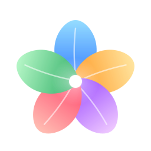

<sub>Made by **Paranoia Dev** · [MIT License](LICENSE)</sub>

</div>
