<div align="center">

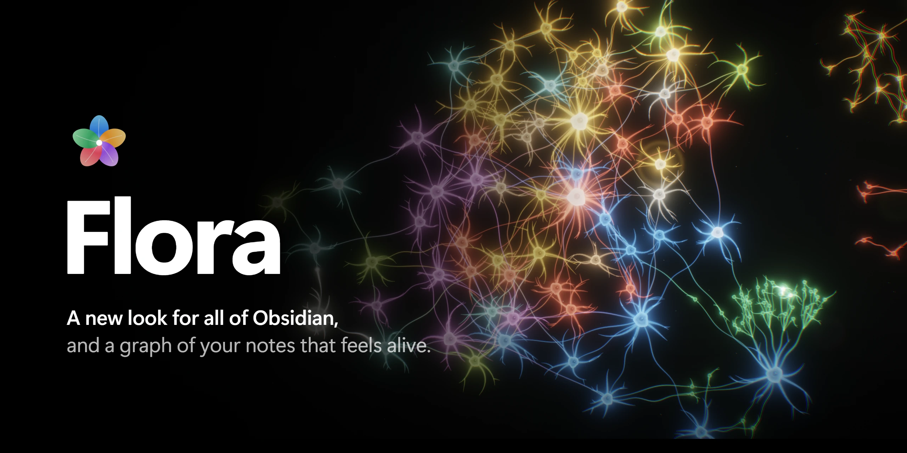

<br />
<br />

<a href="README.md"></a>
<a href="README.ru.md"></a>

<br />

<a href="https://github.com/ParanoaiDev/obsidian-flora/releases/latest"></a>
<a href="https://community.obsidian.md/plugins/flora"></a>
<a href="https://obsidian.md"></a>
<a href="https://github.com/ParanoaiDev/obsidian-flora/releases"></a>
<a href="LICENSE"></a>


<a href="PRIVACY.md"></a>

<br />
<br />

**Flora** переделывает весь Obsidian в спокойном стеклянном стиле в духе iOS<br />
и превращает хранилище в живую нейронную ткань: заметки — клетки, ссылки — светящиеся аксоны,<br />
и по ним бегут импульсы, пока вы думаете.

<br />

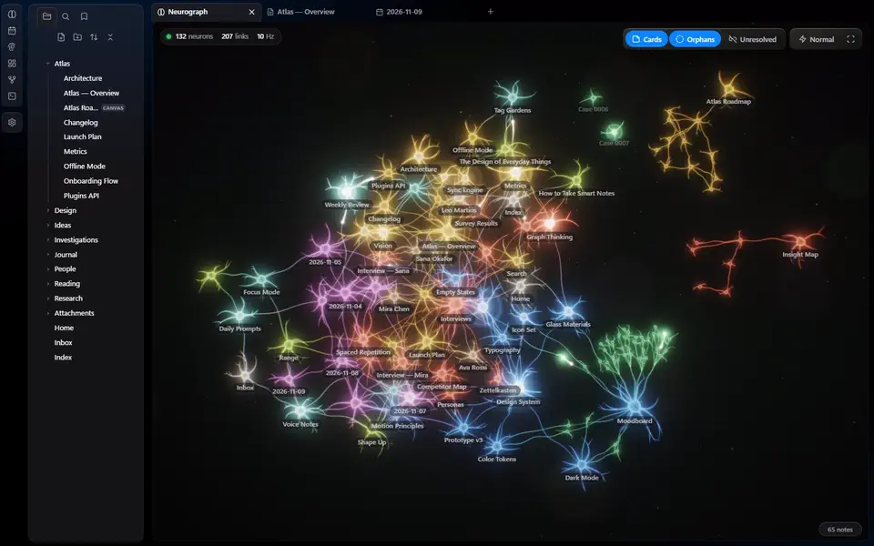

<sub>Записано прямо из нейрографа. Наведите на клетку — она вспыхнет вместе со всем, с чем связана.</sub>

</div>

<br />

## 🆕 Что нового в 6.0

<div align="center">

### Заметки собираются в любую форму

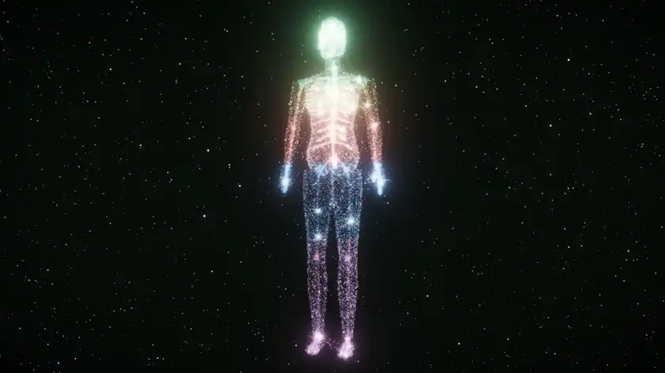

<sub>Снято во Flora 3D в Obsidian. Одно хранилище, пять форм: человек, сердце, бабочка, медуза и ДНК.</sub>

</div>

Во Flora 3D появился **каталог форм**: 17 форм. Пять строятся по вашим связям, двенадцать — фигуры, которые нейроны собирают по шагам. Некоторые живые: сердце бьётся, бабочка машет крыльями, медуза покачивается. Можно ввести слово или выбрать картинку, и нейроны соберут их.

<div align="center">

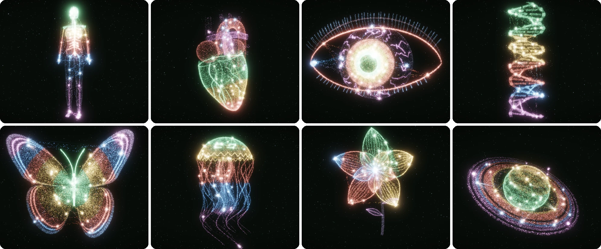

<sub>Человек, сердце, глаз, ДНК, бабочка, медуза, цветок и планета. Яркие звёзды — ваши заметки, пыль вокруг них дорисовывает фигуру.</sub>

<br />
<br />

### Паук, который находит забытые связи

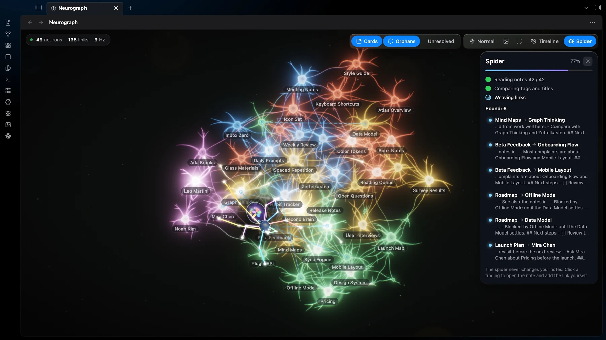

</div>

Нажмите кнопку **Паук** в нейрографе или в обычном графе. Паук из нейронов обходит граф, читает заметки и показывает связи, которых не хватает: заметка упомянута по названию без ссылки, у заметок общие редкие теги или похожие названия. Нажмите на находку, чтобы открыть заметку и поставить ссылку самому. Паук работает на вашем компьютере и не меняет ни одной заметки.

<div align="center">

<br />

### Живые обои под заметками

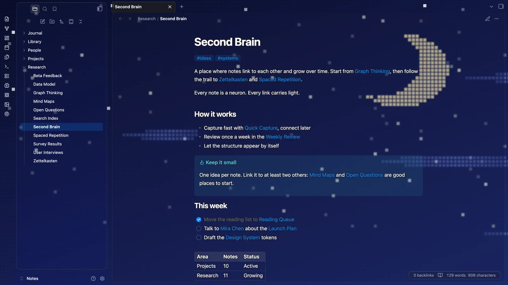
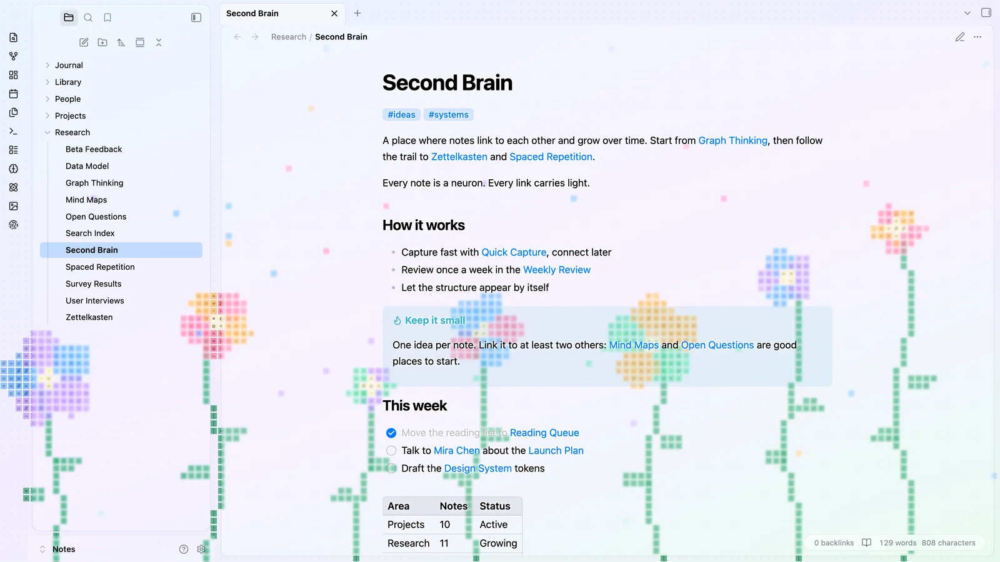

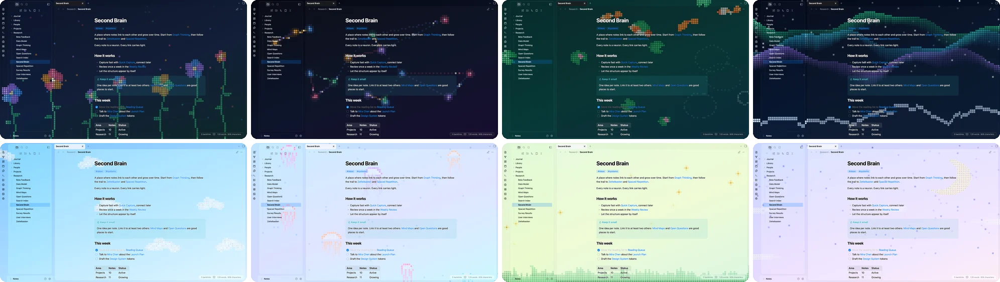

<sub>«Цветение», «Нейроны», «Пруд» и «Сияние» в тёмной теме. «Облака», «Медузы», «Светлячки» и «Лунная ночь» в светлой.</sub>

</div>

Восемь фонов из маленьких клеток, которые всё время плавно движутся. У каждого есть тёмная и светлая версия, а плотность стекла поверх обоев выбираете вы. Обои видны и под нейрографом, Flora 3D, холстами и обычным графом.

Всё остальное, что изменилось, — в [истории изменений](CHANGELOG.md).

<br />

## ✨ Что внутри

<table>
<tr>
<td width="50%" valign="top">

### 🪟 Новый вид всего Obsidian
Стеклянные боковые панели, вкладки-капсулы и плавающая строка состояния над мягким цветным фоном. Текст лежит на сплошной карточке, чтобы его было легко читать. Светлая и тёмная тема, пять акцентных цветов, работает поверх любой темы оформления.

</td>
<td width="50%" valign="top">

### 🧠 Нейрограф
Всё хранилище как живая ткань. Крупные заметки обрастают кронами дендритов, по ссылкам бегут импульсы, холсты распускаются отдельными скоплениями. Наведите на клетку — она вспыхнет, нажмите — откроется заметка.

**Таймлайн** показывает, как росло хранилище: заметки распускаются в том порядке, в каком вы их создавали, а между ними прорастают связи. Можно проиграть, ускорить или перетащить бегунок на любую дату.

</td>
</tr>
<tr>
<td valign="top">

### 🧬 Flora 3D
То же хранилище в объёме. Каждая заметка — нейрон со светлым ядром и своими отростками, ссылки — тонкие нити, а вокруг них десятки тысяч частиц собираются в один светящийся организм. Его можно вращать, влетать в группу, выбрать заметку и пустить свет по её связям, искать по названию, `#тегу` или папке.

В **каталоге форм** 17 форм: организм, мозг, нервы, сферы и галактика строятся по связям, а человека, сердце, глаз, нейрон, ДНК, цветок, дерево, бабочку, медузу, паука, узел и планету с кольцами нейроны собирают по шагам. Или соберите свою форму из слова или картинки. Группировка по папкам, тегам или связям и семь палитр.

</td>
<td valign="top">

### 🕸️ Обычный граф, перерисованный
Граф Obsidian и локальный граф сохраняют всё привычное (фильтры, группы, цвета, поиск, перетаскивание), только рисуются нейронами вместо точек.

</td>
</tr>
<tr>
<td valign="top">

### 🌌 Холсты
Глубокий космос с мягкими туманностями, карточки из тёмного стекла и связи, ставшие живыми аксонами. Импульсы бегут по стрелкам и передаются дальше по схеме.

</td>
<td valign="top">

### 🌱 Стартовый экран
В каждой пустой вкладке вместо «Нет открытого файла» — приветствие, поиск, быстрые действия и недавние заметки поверх живых нейронов.

</td>
</tr>
<tr>
<td valign="top">

### 📅 Журнал дня
Шапка ежедневной заметки: дата, переход между днями, точки месяца, живая полоса с заметками этого дня, заготовка записи и автозадачи — каждая новая строка в разделе **Задачи** сама становится задачей с галочкой.

</td>
<td valign="top">

### 🔎 Доска расследования
Доска дела для OSINT и исследований: объекты (люди, организации, аккаунты, почты, телефоны, домены, IP, места, транспорт, документы), связи, хронология и источники с оценкой по шкале A–F / 1–6, плюс живая карта связей. Каждое дело — обычная заметка.

</td>
</tr>
<tr>
<td valign="top">

### 🕷️ Паук
Паук из нейронов обходит граф и ищет недостающие связи: заметка упомянута по названию без ссылки, у заметок общие редкие теги или похожие названия. Между двумя заметками он плетёт нить и заносит находку в список. Ничего не уходит с компьютера, и паук не правит заметки.

</td>
<td valign="top">

### 🖼️ Живые обои
Восемь движущихся фонов: «Цветение», «Нейроны», «Облака», «Пруд», «Медузы», «Светлячки», «Лунная ночь» и «Сияние», у каждого тёмная и светлая версия. Обои лежат под стеклом заметок и под всеми разделами Flora. Плотность стекла выбираете вы: плотно, поровну или обои впереди.

</td>
</tr>
</table>

Каждую часть можно включить и выключить отдельно в **Настройки → Flora**.

<br />

## 📸 Галерея

<div align="center">

### До и после

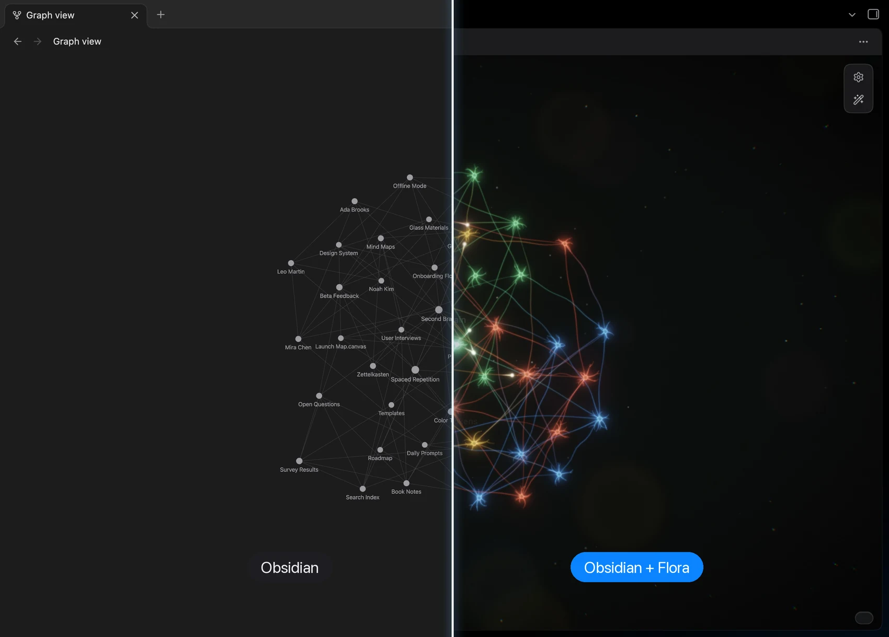

<sub>Слева граф как есть. Справа тот же экран с включённой Flora.</sub>

<br />
<br />

### Всё приложение, светлое и тёмное

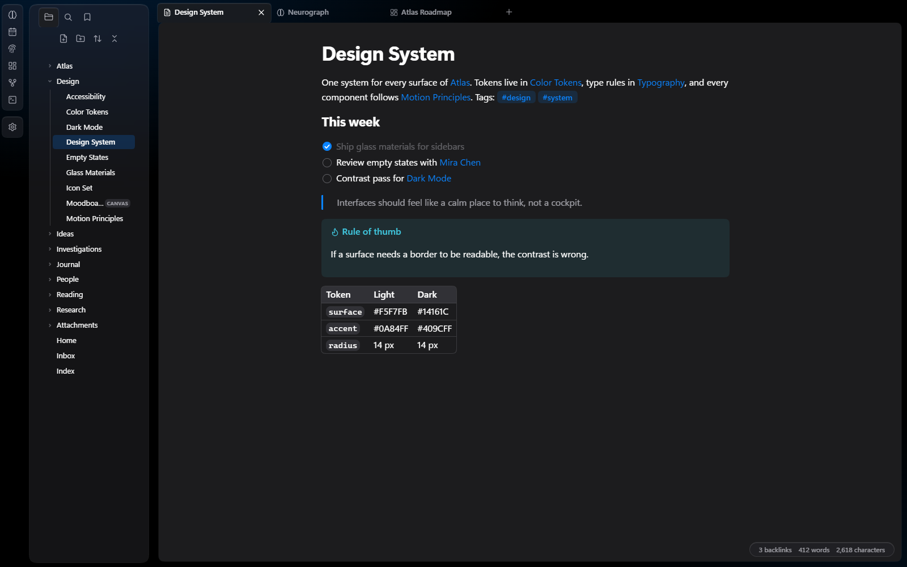
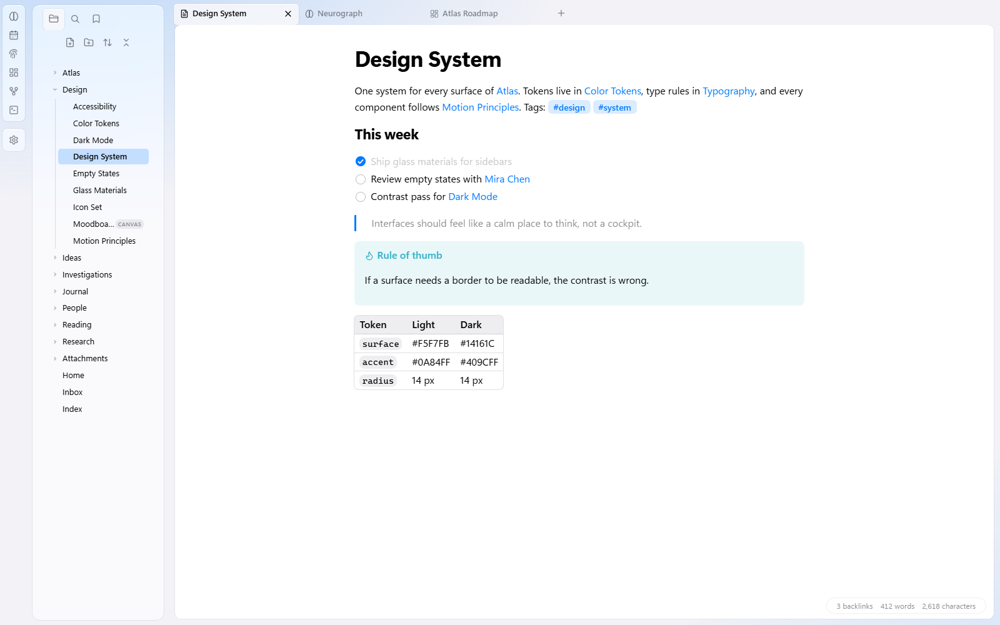

<br />
<br />

### Нейрограф

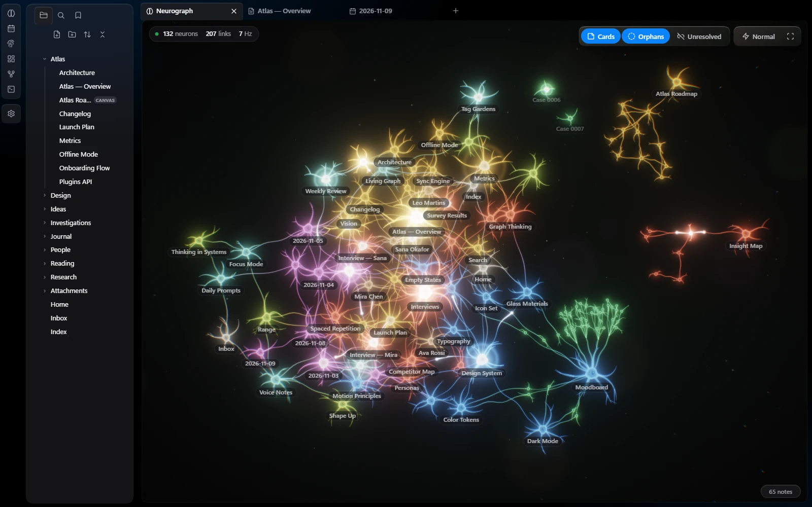

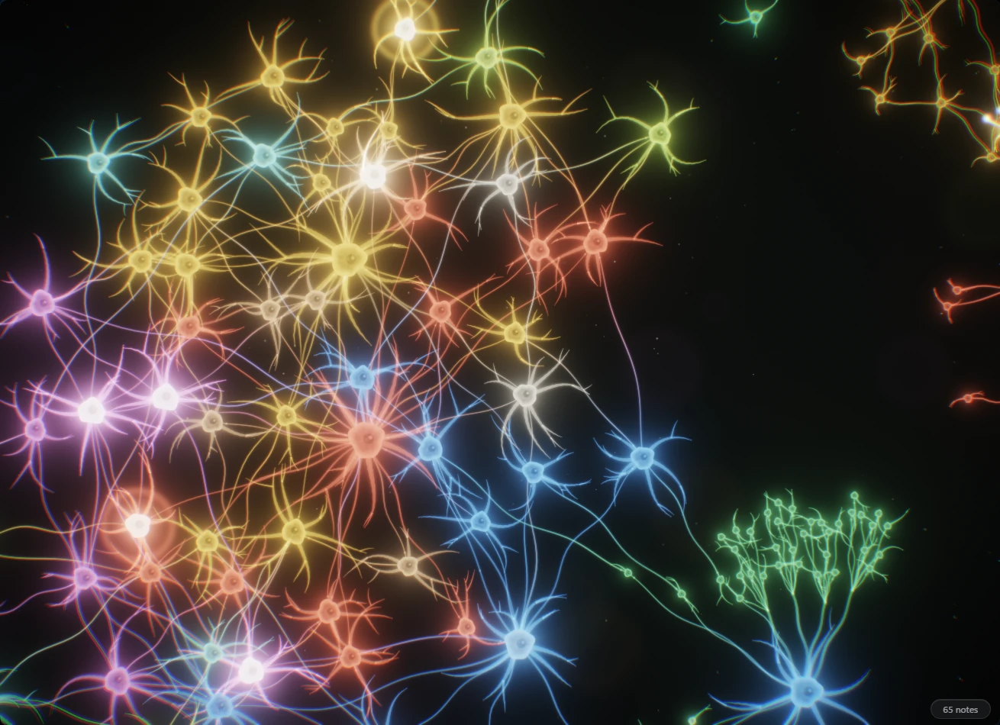

<sub>Вблизи каждая заметка — клетка с ядром, живой мембраной и своими дендритами. Клетки вспыхивают сами, сигнал расходится по настоящим ссылкам.</sub>

<br />
<br />

### Flora 3D

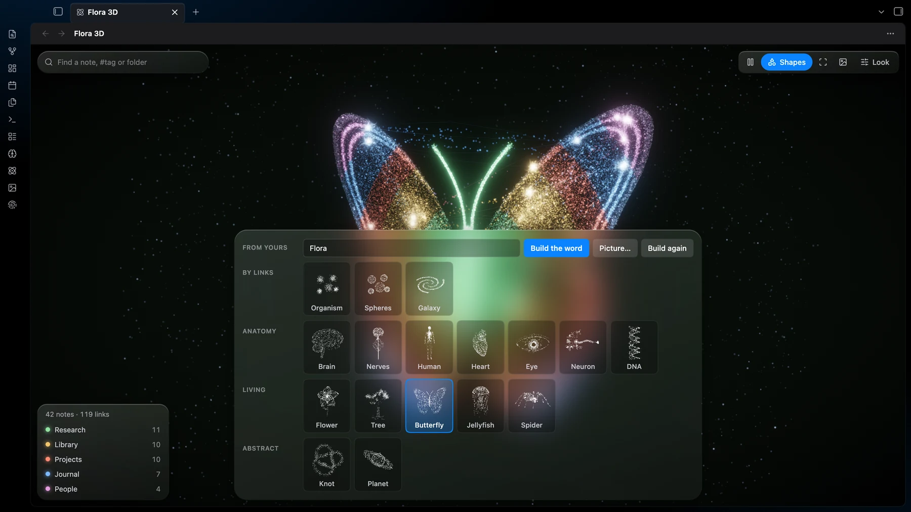

<sub>Каталог форм: 17 форм в четырёх группах и свои формы из слова или картинки.</sub>

<br />
<br />

### Холст

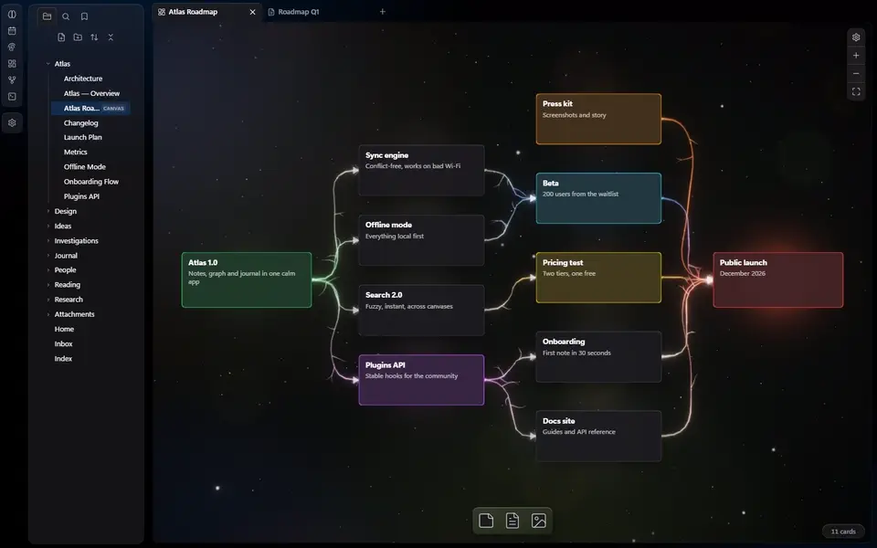

<br />
<br />

### Журнал дня

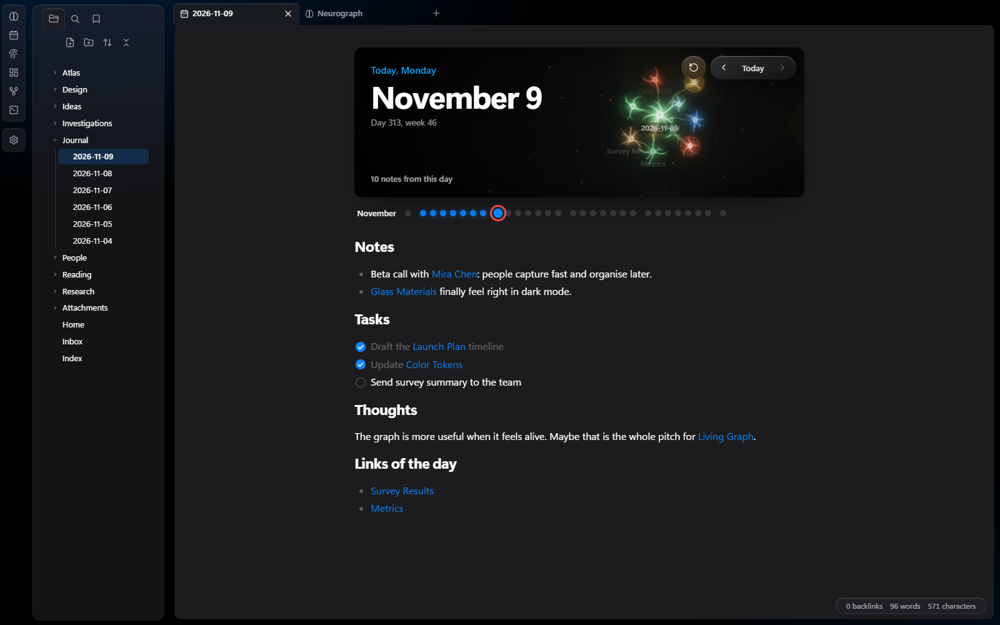
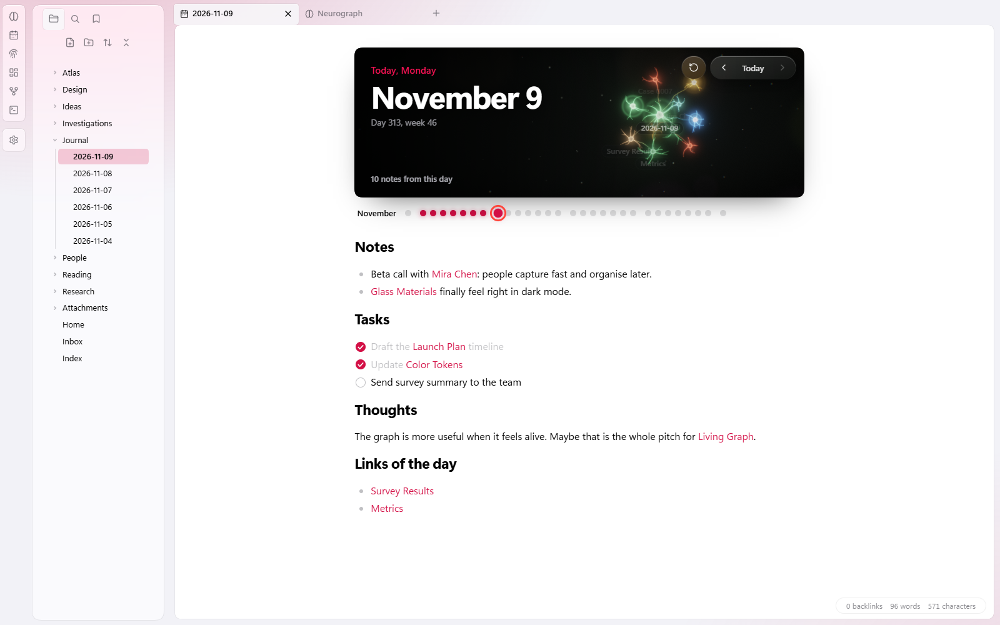

<br />
<br />

### Доска расследования

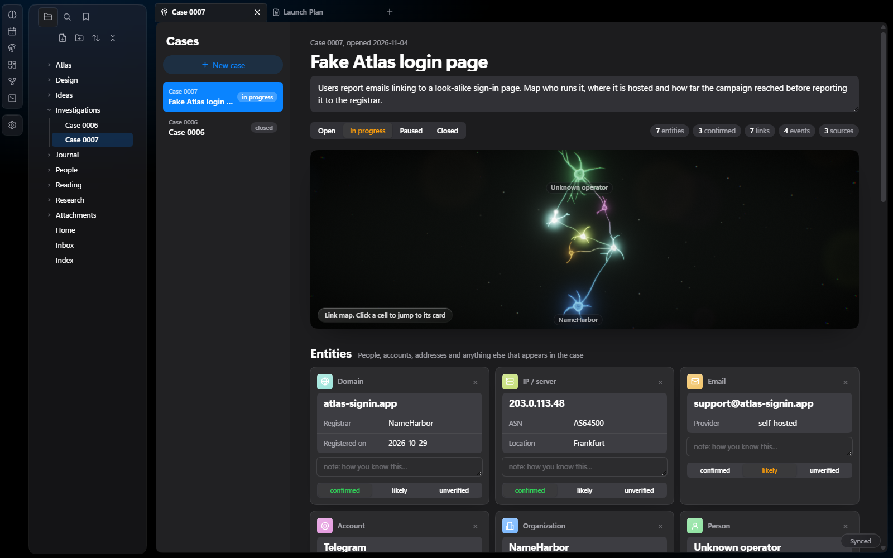

<br />
<br />

### Стартовый экран

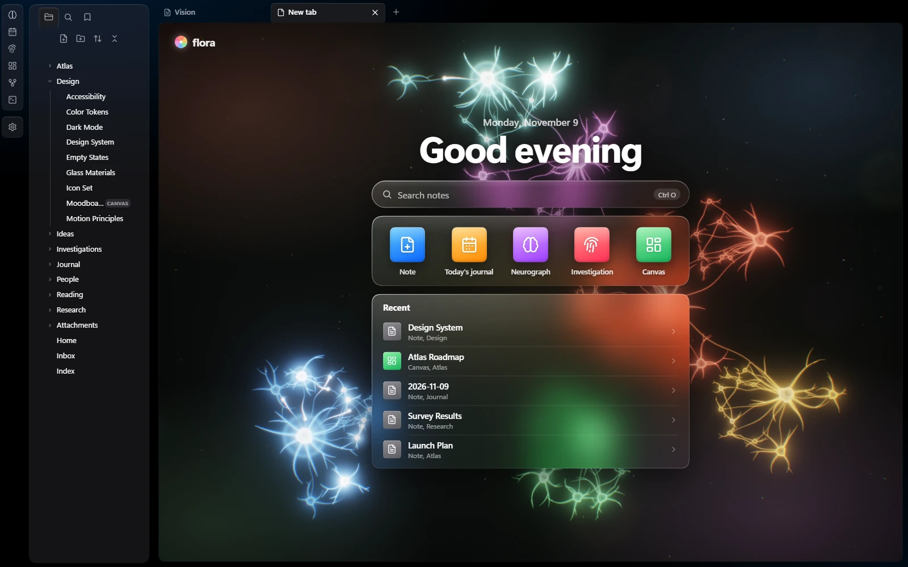

<sub>Появляется вместо «Нет открытых файлов» в каждой пустой вкладке.</sub>

<br />
<br />

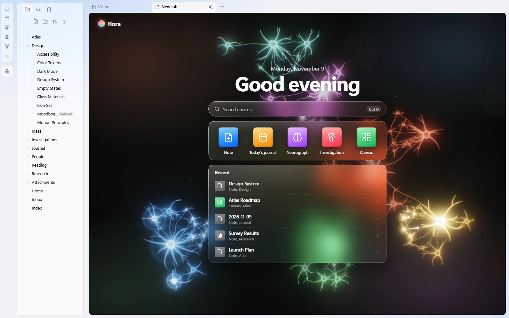

</div>

<sub>На скриншотах — выдуманное демо-хранилище на английском. Реальных данных там нет. Интерфейс плагина переведён на английский и русский и сам выбирает язык Obsidian.</sub>

<br />

## 🚀 Установка

### Из Obsidian (рекомендуем)

Flora есть в официальном [каталоге плагинов Obsidian](https://community.obsidian.md/plugins/flora).

1. В Obsidian откройте **Настройки → Сторонние плагины** и включите их, если они выключены.
2. Нажмите **Обзор**, найдите **Flora**, нажмите **Установить**, затем **Включить**.

Или откройте [страницу Flora в каталоге](https://community.obsidian.md/plugins/flora) и нажмите **Add to Obsidian**.

### Одной командой

Ставит или обновляет Flora из последнего релиза. Скрипт сам найдёт ваши хранилища, спросит, в какое ставить, скачает плагин и включит его. Настройки Flora сохраняются.

**Windows** (PowerShell):

```powershell
irm https://raw.githubusercontent.com/ParanoaiDev/obsidian-flora/main/install.ps1 | iex
```

**macOS и Linux** (Терминал):

```bash
curl -fsSL https://raw.githubusercontent.com/ParanoaiDev/obsidian-flora/main/install.sh | bash
```

Если Obsidian был открыт, перезапустите его. Оба скрипта можно сначала прочитать: [install.ps1](install.ps1), [install.sh](install.sh).

<details>
<summary><b>Указать хранилище самому</b></summary>
<br />

Windows:

```powershell
& ([scriptblock]::Create((irm https://raw.githubusercontent.com/ParanoaiDev/obsidian-flora/main/install.ps1))) -Vault "C:\путь\к\хранилищу"
```

macOS и Linux:

```bash
curl -fsSL https://raw.githubusercontent.com/ParanoaiDev/obsidian-flora/main/install.sh | bash -s -- "/путь/к/хранилищу"
```

</details>

<details>
<summary><b>Вручную</b></summary>
<br />

1. Откройте [последний релиз](https://github.com/ParanoaiDev/obsidian-flora/releases/latest) и скачайте `main.js`, `manifest.json` и `styles.css`.
2. Положите их в папку `<ваше хранилище>/.obsidian/plugins/flora/`. Если папки нет — создайте.
3. В Obsidian откройте **Настройки → Сторонние плагины** и включите **Flora**.

</details>

<details>
<summary><b>Через BRAT</b></summary>
<br />

1. Установите [BRAT](https://github.com/TfTHacker/obsidian42-brat) из каталога плагинов.
2. Выполните **BRAT: Add a beta plugin for testing** и вставьте `ParanoaiDev/obsidian-flora`.
3. Включите **Flora** в **Настройки → Сторонние плагины**.

</details>

<details>
<summary><b>Сборка из исходников</b></summary>
<br />

Нужен только [Node.js](https://nodejs.org), ставить зависимости не нужно.

```bash
git clone https://github.com/ParanoaiDev/obsidian-flora.git
cd obsidian-flora
node build.js
```

`main.js` и `styles.css` появятся в корне репозитория рядом с `manifest.json`. Можно собрать сразу в хранилище:

```bash
node build.js "/путь/к/хранилищу/.obsidian/plugins/flora"
```

</details>

<br />

## ⌨️ Команды

| Команда | Что делает |
| --- | --- |
| **Flora: Открыть нейрограф** | Открывает хранилище живой тканью в новой вкладке |
| **Flora: Открыть Flora 3D** | Открывает хранилище объёмным организмом из частиц в новой вкладке |
| **Flora: Выбрать обои** | Открывает выбор живых обоев |
| **Flora: Журнал сегодняшнего дня** | Открывает или создаёт сегодняшнюю заметку с шапкой журнала |
| **Flora: Открыть доску расследования** | Открывает доску со всеми делами |
| **Flora: Новое дело** | Создаёт заметку дела и открывает её на доске |
| **Flora: Вкл/выкл нейронный вид обычного графа** | Переключает обычный граф между нейронами и исходным видом |

У нейрографа, Flora 3D, живых обоев и доски расследования есть свои значки на левой панели. Паук запускается кнопкой в нейрографе и в обычном графе.

<br />

## ⚙️ Настройки

| Настройка | По умолчанию | |
| --- | --- | --- |
| Язык | Авто | Как у Obsidian. Встроены английский и русский. |
| Дизайн Flora | Вкл | Новый вид всего приложения |
| Акцентный цвет | Синий | Синий, зелёный, оранжевый, розовый или графит |
| Стартовый экран в пустой вкладке | Вкл | Живая ткань, быстрые действия и недавние заметки |
| Нейронный вид обычного графа | Вкл | Граф Obsidian, нарисованный нейронами |
| Нейронный вид локального графа | Вкл | То же для локального графа |
| Шкала и счётчики | Вкл | Счётчики и шкала в углах графа |
| Нейронный вид холстов | Вкл | Космос, стеклянные карточки и живые связи |
| Журнал дня | Вкл | Шапка ежедневной заметки |
| Автозадачи | Вкл | Новые строки в разделе **Задачи** становятся задачами |
| Активность нейронов | ×1 | Как часто клетки вспыхивают сами: от тишины до ×4 |
| Живые обои | Нет | Один из восьми движущихся фонов и плотность стекла над ним |

<br />

## 🔋 Лёгкий по устройству

- **Один проход на видеокарте.** Живые слои рисуются через WebGL2: HDR-свечение, тонмаппинг ACES и клетки инстансингом — один холст на вид.
- **Бюджет кадров.** 30 кадров в секунду в покое, 60 при перетаскивании и масштабировании, 12 когда окно в фоне. Встроенные виды (полоса журнала, карта дела) засыпают, когда уезжают за экран.
- **Без зависаний.** Раскладка считается между кадрами, пока виден загрузочный экран, а физика работает на типизированных массивах и не выделяет память на каждом кадре.
- **Без зависимостей.** Один `main.js` и один `styles.css`, собранные скриптом на 25 строк.
- **Без сети.** Flora ничего не отправляет и не загружает. Подробнее — в [PRIVACY.md](PRIVACY.md).

<br />

## 🧩 Важно знать

- У Obsidian нет официального способа перерисовывать обычный граф и холсты, поэтому эти два скина опираются на внутреннее устройство приложения. Если обновление Obsidian что-то там поменяет, скин просто перестанет подключаться, и вы увидите обычный граф или холст. Ничего не сломается, данные не затрагиваются.
- Дела хранятся обычными заметками в папке **Расследования** (в английском интерфейсе — **Investigations**). Доска правит маленький блок данных внутри заметки и пересобирает под ним читаемую сводку, поэтому дела находятся поиском и на них можно ссылаться.
- Flora только оформляет и раскладывает то, что вы записываете сами. Доска расследования ничего не ищет, не собирает и никуда не обращается.

<br />

## 🗺️ О проекте

| | |
| --- | --- |
| [CHANGELOG.md](CHANGELOG.md) | Что менялось в каждой версии |
| [ROADMAP.md](ROADMAP.md) | Что дальше |
| [CONTRIBUTING.md](CONTRIBUTING.md) | Как устроен код и как предложить изменение |
| [PRIVACY.md](PRIVACY.md) | Что Flora делает и не делает с вашими данными |

<br />

<div align="center">

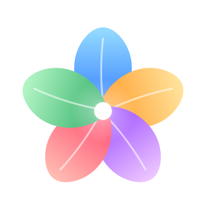

<sub>Сделано **Paranoia Dev** · [Лицензия MIT](LICENSE)</sub>

</div>
